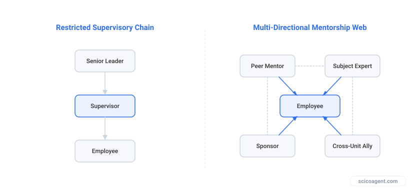
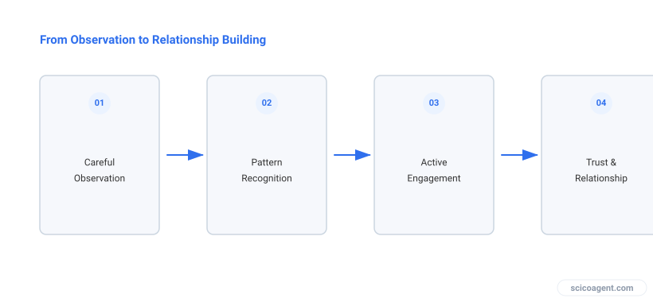

In brief
<ul style="margin:0;padding-left:20px;"><li style="margin:6px 0;line-height:1.5;">Mentorship outside your supervisory chain does not require a formal agreement or an explicit administrative label</li><li style="margin:6px 0;line-height:1.5;">Organic development through regular office hours and informal interactions outperforms cold-emailing requests</li><li style="margin:6px 0;line-height:1.5;">Seeking external guidance improves your perception of organizational justice and relieves pressure on your direct supervisor (Bogner, 2026)</li></ul>

A practical framework for building organic professional guidance without administrative contracts or awkward cold emails.

Learning how to find a research mentor outside your supervisory chain begins with recognizing that your primary supervisor cannot realistically provide every form of career and psychological support you need. Supervisors manage projects, secure funding, and evaluate performance, which creates inherent conflicts of interest when you need impartial career advice. Seeking guidance outside this immediate supervisory chain is a common professional practice that enhances long term career satisfaction (Bogner, 2026). When researchers establish supportive ties beyond their lab, their perception of organizational justice and their relationship with their direct supervisor both improve significantly (Miller et al., 2010).

*The structural shift from a single supervisory channel to an open mentor network*

## Why the Supervisory Chain Fails as a Sole Source of Guidance

The structural design of academic hierarchies places immense pressure on the single dyadic relationship between a researcher and their supervisor. Because supervisors hold direct power over funding, graduation timelines, and manuscript signoffs, graduate students and postdocs often hesitate to discuss professional anxieties, interpersonal lab conflicts, or alternative career trajectories with them. This dynamic makes a secondary, external guide essential. 

Mentorship does not require a formal agreement or an explicit label to be effective. In fact, attempting to establish mentorship through a bureaucratic process or a cold email asking someone to be your mentor almost always creates friction. People are naturally hesitant to sign up for an undefined administrative obligation with a stranger. Real guidance operates differently. It grows out of shared intellectual interests and repeated low stakes interactions.

## How Can I Find a Mentor (Not a Supervisor) Through Organic Engagement?

Finding an external guide relies on a four step behavioral framework that replaces solicitation with observation and gradual interaction. 

*The organic mentorship pathway*

First, observe and emulate. Identify individuals across your department or institution whose research, teaching, or professional relationships you genuinely admire. Watch how they handle peer review, how they run lab meetings, or how they mentor their own students from a distance. 

Second, engage informally. Move from passive observation to active presence when opportunities arise. Regular office hours, departmental seminars, or informal campus events provide the appropriate venues for initiating contact. You do not need a grand pretext to attend a faculty member's office hours. Asking a specific question about a recent paper they published or a method they discussed in a seminar is enough to start a conversation.

Third, ask specific questions. When you secure face time, avoid broad requests for career advice. Instead, bring concrete technical problems, experimental design questions, or narrow concerns about navigating specific professional hurdles. Specific questions respect the recipient's time and demonstrate your active engagement with your own research.

Fourth, build the relationship over time. Allow the interaction to recur naturally across months rather than expecting a single conversation to yield a deep bond. Mentorship is a two way street, and offering support to the senior researcher when possible, such as sharing a relevant dataset, assisting with an organizational task, or engaging thoughtfully in their seminar discussions, strengthens the connection.

## Navigating Pitfalls and Managing Professional Boundaries

Attempting to fast track professional relationships usually backfires. Forcing a mentorship connection by demanding regular meetings or formalizing a title creates an artificial obligation that most busy researchers will avoid. Let the relationship develop like any other human relationship, governed by mutual respect and shared curiosity.

You must also avoid assuming that an external mentor will automatically become a coauthor, a direct collaborator, or a formal sponsor. While a mentor may eventually transition into a sponsor who actively supports your career advancement during hiring or grant committees, that status is earned through sustained trust rather than granted by default. Respect the boundaries of the relationship, accept the specific type of advice they are willing to offer, and do not treat them as a surrogate supervisor.

The underlying mechanism here reveals something counterintuitive about how scientific communities actually operate. Mentorship is not a role you assign to a person or a contract you negotiate, but a residual byproduct that forms only when you stop looking for a mentor and instead focus entirely on solving narrow technical problems with someone who shares your intellectual curiosity.

## FAQ

### How can I find a mentor (not a supervisor)?
You find a mentor by observing researchers whose professional qualities you admire and initiating contact through informal settings like office hours or departmental events. The relationship grows organically when you ask specific questions about shared intellectual interests rather than sending cold emails requesting formal mentorship.

### Can a mentor become a formal sponsor later?
Yes, an established mentor can eventually transition into a sponsor who actively supports your career advancement in committees or hiring decisions. However, this transition occurs naturally over time through sustained professional trust and is never guaranteed from the outset.

### What are the pitfalls of forcing a mentorship connection?
Forcing mentorship through formal agreements or aggressive cold outreach creates an artificial obligation that typically leads to withdrawal. Mentorship functions best when it develops without administrative labels through mutual intellectual engagement.

## Further reading

- [How can I find a mentor (not a supervisor)?](https://academia.stackexchange.com/questions/187049/how-can-i-find-a-mentor-not-a-supervisor) (Q&A discussion)
- [Find Mentors and Supportive Supervisors](https://doi.org/10.4324/9781003745044-19) (paper, Bogner, 2026)
- [Auditor and non‐mentor supervisor relationships](https://doi.org/10.1108/02686901111090817) (paper, Miller et al., 2010)
