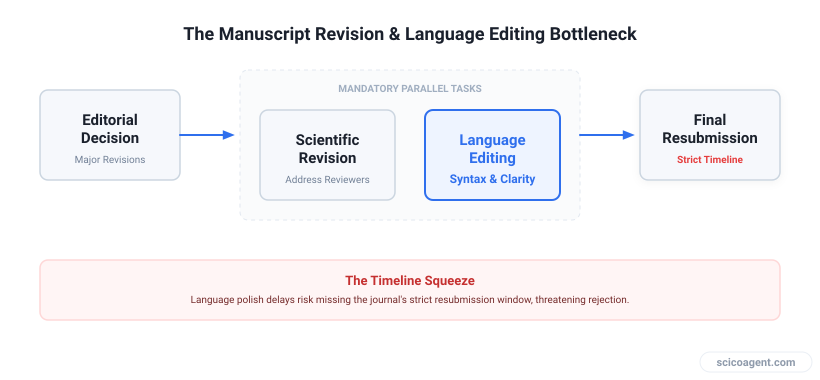
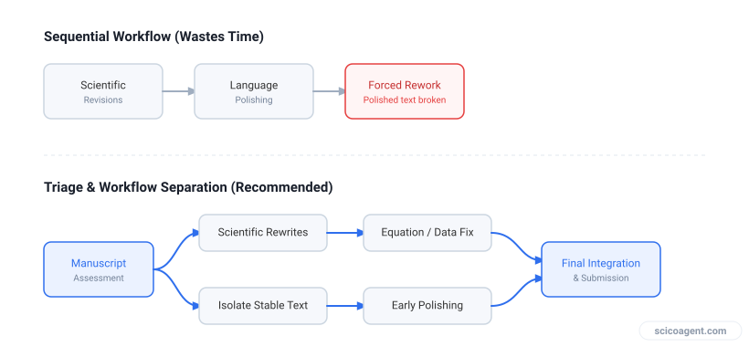

In brief
<ul style="margin:0;padding-left:20px;"><li style="margin:6px 0;line-height:1.5;">Journals frequently condition acceptance on professional language editing</li><li style="margin:6px 0;line-height:1.5;">External editing services often require ten days or more, threatening tight resubmission deadlines</li><li style="margin:6px 0;line-height:1.5;">Technical proofreading requires checking units and notation alongside grammar</li><li style="margin:6px 0;line-height:1.5;">Separating substantive reviewer responses from surface polish preserves critical time</li></ul>

Practical approaches for managing journal resubmission windows when professional language polish is mandatory.

## Understanding the Editorial Demand

Receiving a manuscript decision that requires major revisions alongside mandatory language editing is a familiar stress point in academic publishing. When an editor at an Elsevier journal or another major publisher flags a paper for language issues, they are rarely objecting solely to grammatical errors. They are usually responding to syntax that obscures the underlying logic of the argument, making it difficult for reviewers to evaluate the scientific contribution fairly.

*The timeline squeeze between reviewer responses and language editing*

Most institutional researchers face a strict deadline, often thirty days or less, to resubmit a revised manuscript. If an external professional editing service takes ten or eleven days to return the document, the actual window to address reviewer comments shrinks dramatically. Relying on traditional external proofreading services during a tight revision cycle introduces a severe scheduling risk.

## Triage and Workflow Separation

The most common mistake researchers make when facing a combined scientific and linguistic revision is tackling both tasks sequentially in a single pass. This approach wastes precious hours. Scientific revisions require altering equations, running supplementary experiments, or rewriting entire discussion sections based on reviewer critiques. If you apply language polishing while the scientific arguments are still shifting, you will end up rewriting polished text.

*Comparison of sequential versus parallel revision workflows*

Effective triage requires separating the workflow into distinct phases. Phase one focuses entirely on addressing reviewer comments and updating data, figures, and code. During this phase, ignore surface grammar entirely unless an awkward phrasing directly misrepresents a scientific claim. Phase two addresses the structural flow and readability of the manuscript once the scientific content is locked.

| Revision Phase | Primary Objective | Common Pitfall |
| --- | --- | --- |
| Phase One | Address reviewer critiques and update data | Polishing prose before arguments are finalized |
| Phase Two | Refine grammar, syntax, and flow | Missing unit, notation, or equation errors |
| Phase Three | Final compile and format check | Submitting without verifying tracked changes |

## The Technical Limitations of Standard Tools

When time is short, researchers often turn to standard word processor spell-checkers or generic artificial intelligence writing assistants. These tools present significant hidden risks in technical writing. Standard grammar checkers rely on general linguistic corpora. They lack awareness of scientific notation, unit formatting rules, and mathematical context.

For instance, a generic spell-checker will flag uncommon chemical abbreviations as errors or fail to notice when a minus sign is accidentally dropped from an exponent. Worse, many general writing tools cannot parse native LaTeX source files or complex Word documents containing embedded equations, forcing researchers to copy text into plain text boxes and risking broken macros or lost formatting.

When you need to review a manuscript for technical accuracy alongside linguistic polish, specialized tools can help. We built Benjamin to do this part automatically. Maintaining the integrity of units, equations, and domain-specific terminology requires domain-aware verification rather than generic rewriting.

## Verifying Edits Without Rewriting

Any intervention in the text, whether manual or automated, must preserve the precise meaning of the research. Black-box rewriting tools that generate entirely new paragraphs often introduce subtle distortions of scientific claims. If a proofreading tool rewrites a sentence describing a binding affinity or a reaction rate, it can inadvertently alter the quantitative reality of your data.

To maintain control, researchers must insist on verifiable review mechanisms, such as tracked changes in Word documents or explicit diff outputs in LaTeX. Every suggested modification should be transparent, allowing the author to evaluate whether the grammar correction respects the technical nuance of the discipline.

## The Deeper Reality of Journal Language Standards

The persistent friction around journal language requirements is often viewed as an administrative hurdle or a bias against non-native speakers. However, the core mechanism driving these editorial policies is cognitive load. Reviewers operating under heavy workloads struggle to parse complex scientific arguments when the syntactic structure deviates from standard academic conventions in the target field. Mandatory language editing is rarely about grammar, functioning instead as a structural proxy for conceptual clarity where dense prose masks weak methodology.
