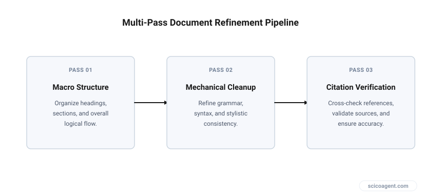

In brief
<ul style="margin:0;padding-left:20px;"><li style="margin:6px 0;line-height:1.5;">Overwhelm occurs when situational demands exceed available cognitive resources</li><li style="margin:6px 0;line-height:1.5;">A thesis is a training exercise rather than your final career masterpiece</li><li style="margin:6px 0;line-height:1.5;">Structured triage isolates macro structural flaws from micro mechanical errors across passes</li></ul>

A structured triage framework to handle massive manuscripts under tight deadlines without burning out.

Knowing how to proofread a 200 page thesis in one weekend starts with accepting a hard truth. You cannot read two hundred pages of technical prose word by word in forty eight hours and catch every error. When an individual perceives that situational demands exceed their available resources, the result is cognitive overwhelm (Dael et al., 2025). Symptoms include heightened alertness combined with physical fatigue, mental freezing, and eventual withdrawal (Dael et al., 2025). Trying to achieve absolute perfection under these conditions triggers avoidance and severe anxiety, paralyzing your progress right when time is scarcest (Azwar et al., 2023). 

To survive a weekend deadline, you must abandon the idea of linear reading. Instead, you need a multi pass triage protocol that separates structural integrity from mechanical cleanup.

## Why Massive Manuscripts Trigger Cognitive Overwhelm

The panic of a looming thesis deadline rarely stems from poor writing alone. It arises from the sheer volume of text colliding with the psychological weight of completion. Many students struggle with the perception that their daily progress fails to align with the reality of their ambitious goals, fueling a cycle of procrastination (Azwar et al., 2023). 

Furthermore, researchers frequently view a thesis as their definitive intellectual legacy rather than what it actually is, which is a school drill and a foundational first work (Donohue et al., 2021). When you treat every paragraph as if it must win a prize, editing grinds to a halt. Compounding this, difficulty in finding or receiving adequate guidance from a supervisor leaves students isolated, forcing them to manage setbacks and obstacles entirely on their own (Donohue et al., 2021). Breaking the deadlock requires a mechanical approach to editing that bypasses emotional attachment.

*The three pass triage framework for rapid weekend editing*

## The Weekend Triage Protocol

Divide your weekend into three distinct phases. Each phase targets a different layer of the manuscript, ensuring you do not get bogged down in comma placements while your core arguments remain unverified.

### Saturday Morning: The Macro Structural Audit
Do not open your document to fix spelling on page five. Instead, spend Saturday morning reading only your abstracts, introduction chapters, and chapter conclusions. Your goal is verifying that the logical thread holds together across the entire document. Check that your central research question matches the data presented in your final chapters. If a section deviates from this core thread, flag it for condensation or removal rather than rewriting it sentence by sentence.

### Saturday Afternoon: The Mechanical Cleanup Pass
Once the structure is sound, turn your attention to the mechanics of the text. This is where formatting inconsistencies, stray notation errors, and unit mismatches creep in during late night writing sessions. Standard spell checkers often miss unit symbols, mathematical subscripts, and inline notation errors that distract external readers. We built Benjamin to automate these mechanical checks directly in LaTeX and Word documents. Work through your chapters section by section, focusing exclusively on grammar, consistent terminology, and numerical formatting.

### Sunday: The Reference and Constraint Check
By Sunday, mental fatigue will be setting in, which makes this the ideal time for automated or semi automated verification. Check every in text citation against your bibliography file. Verify that every figure and table is explicitly referenced in the surrounding text and that numbering sequences remain unbroken after your structural cuts from Saturday. 

## Frequently Asked Questions

### How do I stop procrastinating when the deadline is only days away?
Procrastination at this stage is usually a symptom of cognitive overload caused by an undefined task scope. Break the remaining work into micro tasks such as checking chapter three equations or verifying table captions, and cross them off one by one to reduce anxiety.

### Should I rewrite entire chapters during a weekend proofreading session?
No. A weekend proofreading session is for correction and tightening, not for generating new prose or restructuring arguments. If a chapter requires a total rewrite, scale down the ambition of that section to match what can be clearly explained within your remaining time limit.

### How do I handle missing citations or broken cross references?
Search your manuscript for placeholder text or bracketed question marks immediately. Resolve every missing reference by either locating the correct source or cutting the unsupported claim entirely, as incomplete citations invite immediate skepticism from reviewers.

## Further reading

- [Is it better to have a strong thesis, or to follow personal interests during PhD?](https://academia.stackexchange.com/questions/129700/is-it-better-to-have-a-strong-thesis-or-to-follow-personal-interests-during-phd) (Q&A discussion)
- [Impacts of the COVID-19 Pandemic on Doctoral Students’ Thesis/Dissertation Progress](https://doi.org/10.28945/4818) (paper, Donohue et al., 2021)
- [Reaching point break: understanding the lived experience of being overwhelmed](https://doi.org/10.3389/forgp.2025.1590159) (paper, Dael et al., 2025)
- [The role of reality counseling to improve students' responsibility in thesis completion procrastination](https://doi.org/10.47750/pegegog.13.03.42) (paper, Azwar et al., 2023)
