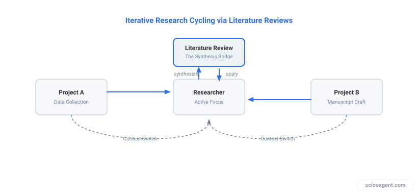
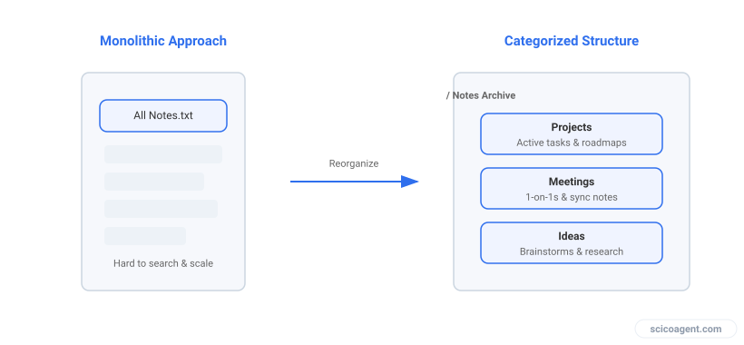

In brief
<ul style="margin:0;padding-left:20px;"><li style="margin:6px 0;line-height:1.5;">Implementing regular progress reporting maintains consistent momentum across all active investigations</li><li style="margin:6px 0;line-height:1.5;">Creating a detailed handover note before pausing a project eliminates the productivity dip of returning</li><li style="margin:6px 0;line-height:1.5;">Organizing research notes into categorized files prevents information loss compared to monolithic documents</li></ul>

A practical framework for balancing multiple investigations without succumbing to the hidden costs of context switching.

Working on multiple research projects is a standard reality for academic researchers, postdocs, and graduate students. While juggling multiple investigations can prevent burnout by allowing you to switch tasks when you hit a wall, it also introduces significant friction. Task switching carries a high cognitive cost that often leads to low productivity during the initial days of returning to a stalled project. Navigating this environment requires deliberate operational habits rather than sheer willpower.

## The mechanics of switching costs and concurrency

When you pivot from one research topic to another, your brain requires time to reload context, recall recent experimental parameters, and re-establish the logical thread of the analysis. This transition period results in measurable downtime. However, running concurrent projects offers distinct structural advantages. It mitigates the risk of failure associated with relying on a single, potentially exhausting research endeavor. It also allows you to engage with a wider variety of collaborators, journals, and academic spaces. 

To capture these benefits while minimizing downtime, you need reliable mechanisms that bridge the gaps between active phases of work.

*A cyclic workflow connecting active research projects through scheduled literature review transitions*

## A practical framework for managing multiple projects

Managing multiple investigations successfully depends on externalizing your workflow so that re-entry requires minimal cognitive overhead. You can implement four concrete practices to maintain progress across all fronts.

First, implement regular progress reporting. Set up external deadlines and scheduled progress meetings to ensure consistent momentum and prevent long periods of inactivity on any single project. When accountability is built into the calendar, projects cannot quietly stall in the background.

Second, create a handover note before putting a project on hold for several weeks or more. When pausing a project, write a brief document detailing your current status, completed tasks, and planned next steps. This explicit handoff eliminates the blank-page syndrome when you finally return to the material.

Third, schedule dedicated literature time. Reading recent papers in a secondary field serves as a productive way to switch gears between different project topics. It keeps you current on multiple subjects while providing a low-stakes mental break from your primary experimental or writing tasks.

Fourth, delegate manual labor whenever possible. When tasks are repetitive and do not require your specific expertise, hand them off to research assistants or interns to increase your overall research capacity. 

## Structuring research notes to prevent retrieval failure

As the number of active projects grows, the volume of generated information can quickly overwhelm your personal filing system. Organizing research notes into multiple, categorized files is far more effective than maintaining a single, massive document. 

Avoid using a miscellaneous folder or file entirely. A miscellaneous repository inevitably becomes a dumping ground for unorganized and unretrievable information. Digital notes should be sorted by explicit categories from the beginning, and physical notebooks should be avoided for critical tracking because they are easily lost and difficult to search compared to digital alternatives.

*Moving from a single massive document to categorized subfolders*

## FAQ

### How do you handle returning to a project after a long break?
You should rely on a previously written handover note that outlines your completed tasks and immediate next steps. This document bypasses the cognitive penalty of trying to remember where you stopped.

### How often should progress meetings be scheduled?
Frequency depends on your team size and project phase, but the goal is to establish external deadlines that prevent any single project from sitting dormant for weeks at a time.

### Why are monolithic documents ineffective for large research volumes?
A single massive file becomes difficult to search and maintain as information accumulates. Breaking notes into categorized, distinct files keeps information retrievable.

## Complexity and emergence in research management

The traditional view of project management assumes that a complex schedule can be fully mapped out in advance through rigid planning. In academic research, however, project management in complex environments often requires methods that emerge from interactions between project elements rather than rigid, a priori planning (Pundir et al., 2007). Because practice varies widely across disciplines and there is no single universal theoretical framework for handling research complexity, your strategy must remain adaptable to the unpredictable nature of scientific inquiry.

## Further reading

- [How do you manage to work on multiple research projects?](https://academia.stackexchange.com/questions/16371/how-do-you-manage-to-work-on-multiple-research-projects) (Q&A discussion)
- [How to keep and organize a research journal/log/diary/notebook?](https://academia.stackexchange.com/questions/15951/how-to-keep-and-organize-a-research-journal-log-diary-notebook) (Q&A discussion)
- [Towards a complexity framework for managing projects](https://research.nitie.ac.in/publication/towards-a-complexity-framework-for-managing-projects) (paper, Pundir et al., 2007)
