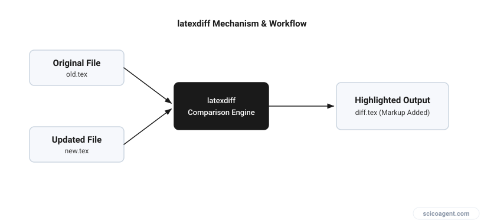
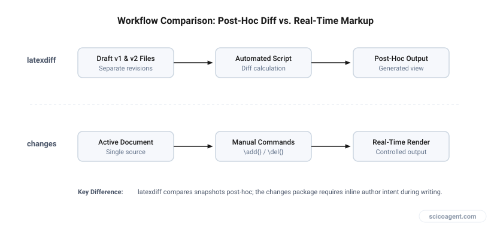

<div class="tldr" style="border:1px solid #e2e8f0;border-left:4px solid #2f6fed;background:#f8fafc;border-radius:10px;padding:16px 20px 14px;margin:0 0 30px;"><p style="margin:0 0 8px;font-weight:700;font-size:.8em;letter-spacing:.08em;text-transform:uppercase;color:#2f6fed;">In brief</p><ul style="margin:0;padding-left:20px;"><li style="margin:6px 0;line-height:1.5;">LaTeX lacks a native track changes feature, requiring external tools to manage revisions.</li><li style="margin:6px 0;line-height:1.5;">The latexdiff utility automatically compares two source files and compiles a visual diff document.</li><li style="margin:6px 0;line-height:1.5;">The changes package enables manual inline markup but leaves no automated path to clear the revision baseline.</li></ul></div>

A practical guide to latexdiff, manual markup packages, and version control workflows for academic writing.

LaTeX does not have a native, built-in track changes feature equivalent to word processors. When you share a document with co-workers or advisors, expecting a neat sidebar of accepted or rejected paragraphs fails because LaTeX compiles plain text files into typeset output. You are tracking instructions for a compiler rather than a static page of text. Understanding how to bridge this gap preserves your sanity during the revision cycle.

## Automated Comparison with latexdiff

When you want to compare two versions of a document and generate a visual diff automatically, `latexdiff` is the standard tool. It parses the syntax tree of your source files, identifies insertions and deletions, and outputs a new LaTeX file containing formatting commands for changes.

Use this command in your terminal:

```bash
latexdiff original.tex modified.tex > diff.tex
```

Compile `diff.tex` with pdfLaTeX. Additions appear in blue text, while deletions are struck through in red. This method shines when you finish a draft, share it, receive a modified file back from a co-author, and need to see every altered word without manually hunting through raw code.


*Figure 1: Generating a diff document from two LaTeX sources.*

## Manual Markup During Drafting

When you need to manually mark specific edits during the drafting process, the `changes` package provides fine-grained control. Import the package in your preamble:

```latex
\usepackage{changes}
```

Inside your text, use explicit commands for your edits:

```latex
\usepackage{changes}
\added{new text}
\deleted{old text}
\replaced{new}{old}
```

When you want to inspect how the clean manuscript looks without markup clutter, pass the `final` option to the package declaration: `\usepackage[final]{changes}`. This disables the visual markup while keeping the commands intact in your source code.


*Figure 2: Choosing between automated comparison and manual markup based on your revision stage.*

## The Pitfalls of Clearing Revisions

The `changes` package does not provide a native workflow for accepting changes to clear the document for a new round of revisions. If you accumulate hundreds of additions and deletions, your source code becomes cluttered. Automated scripts, such as `awk` scripts or text editor macros in Vim, are frequently used to strip these commands, but these methods struggle with nested LaTeX groupings or multi-line changes. Attempting to strip tags with a simple regular expression often breaks your document structure by accidentally deleting closing brackets or macro arguments.

## Version Control for Multi-Author Collaboration

When collaborating with multiple people on the same document, version control systems like Git or SVN offer a robust alternative to file emailing. By committing changes at paragraph boundaries, you can review exact diffs line by line using commit history. While it requires discipline from all co-authors to avoid merge conflicts in complex mathematical environments, it remains the most reliable archive of how a manuscript evolved over months of revision.

We built Benjamin to generate tracked changes for LaTeX manuscripts automatically.

We treat tracking changes as a mechanical chore of marking text, but LaTeX reveals something deeper about academic thought. Because code forces us to externalize our structure before it renders, tracking changes in a manuscript is not really about recording what words changed. It is about exposing the precise path our assumptions took as they evolved from a rough draft into a stable argument.

## FAQ

How do I compile a latexdiff file in pdfLaTeX?
Run the latexdiff command in your terminal to generate the diff file, then compile the resulting `.tex` file using pdfLaTeX in your standard editor or command line environment.

Can I use the changes package to automatically accept edits?
No, the changes package lacks a built-in mechanism to accept edits and reset the baseline automatically, meaning you must manage cleanup manually or via version control.

Why do automated scripts fail when removing change commands?
Scripts like awk or simple text macros fail because they cannot reliably parse nested LaTeX braces and multi-line markup environments without breaking the surrounding syntax.

## Further reading

- [Track changes option in pdfLaTeX](https://tex.stackexchange.com/questions/194284/track-changes-option-in-pdflatex) (Q&A discussion)
- [Tracking changes](https://tex.stackexchange.com/questions/200178/tracking-changes) (Q&A discussion)
