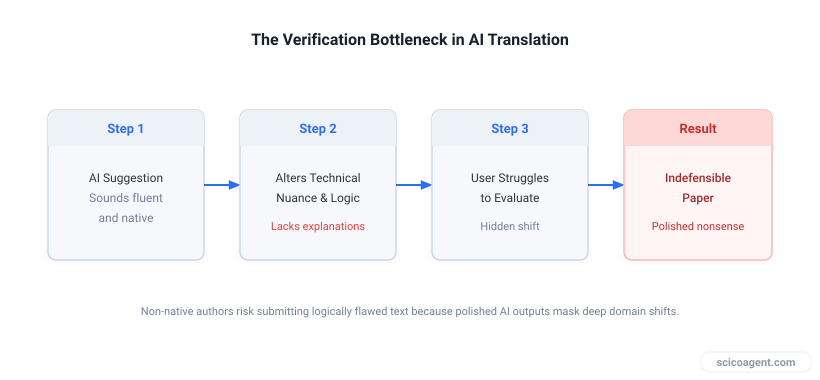

<div class="tldr" style="border:1px solid #e2e8f0;border-left:4px solid #2f6fed;background:#f8fafc;border-radius:10px;padding:16px 20px 14px;margin:0 0 30px;"><p style="margin:0 0 8px;font-weight:700;font-size:.8em;letter-spacing:.08em;text-transform:uppercase;color:#2f6fed;">In brief</p><ul style="margin:0;padding-left:20px;"><li style="margin:6px 0;line-height:1.5;">Non-native English speakers face structural disadvantages in academic publishing</li><li style="margin:6px 0;line-height:1.5;">AI translation tools can improve writing proficiency but introduce unique verification risks</li><li style="margin:6px 0;line-height:1.5;">Authors retain full ethical and scientific responsibility regardless of tool usage</li></ul></div>

How to refine manuscript language without accidentally importing logical errors or violating editorial expectations.

For non-native English speakers, is it ok to use ChatGPT as a translation assistant? The short answer is yes, but only when you already possess the subject-matter proficiency to fully understand and verify every change the model suggests. Non-native English speakers face significant career and effort-related disadvantages due to language barriers in scientific activities like writing and presenting [2] (Amano et al., 2023). While AI tools can effectively provide personalized feedback and improve English writing proficiency [3] (Masoudi, 2024), relying on them blindly introduces subtle hazards that traditional spell-checkers never created.

## Why general-purpose AI tools create hidden risks in manuscripts

Using AI for spelling, grammar, and style corrections is generally considered unproblematic in academic contexts [1]. However, the primary risk of AI translation is that models lack human judgment, ethics, and transparency regarding how they reach decisions [1]. A generic chat interface will rewrite sentences to sound fluent, but fluency does not equal validity. AI-generated text can mimic the structure of expert writing while containing logical nonsense, which is harder to detect than human errors [1].

Non-native speakers often struggle to evaluate AI-generated paraphrases because these tools typically lack explanations for their suggestions [4] (Kim et al., 2023). When an assistant changes a technical phrase into something that sounds more native, it may inadvertently alter the specific physical mechanism or statistical nuance you intended to describe. If you lack the deep domain mastery to spot that shift, you risk submitting a paper that sounds polished yet states something technically indefensible.


*The verification bottleneck in AI translation*

## A safe workflow for AI-assisted translation

If you choose to use a large language model to assist with drafting or polishing, you must enforce a strict verification boundary. The necessity of using an AI tool is inversely related to the safety of using it; if you rely on it because you cannot judge the output, the risk is dangerously high [1].

Instead of asking a general model to rewrite your whole paper from scratch, isolate specific paragraphs and give explicit framing constraints. Use a prompt that restricts the model from altering your technical terms or substantive claims.

```
As a non-native english speaker I am writing a scientific article, so you are my english language proof reading services assistant: Please correct the following paragraph for spelling, grammar and style. Please do not alter the technical content but focus on improving the language only.
```

After running the prompt, compare the output sentence by sentence against your original meaning. If a suggested phrasing sounds sophisticated but you cannot explain why it is structured that way, revert to your original phrasing or consult a human colleague.

## Managing editorial disclosure and varying institutional standards

The author of a scientific paper retains full responsibility for the accuracy of the content, regardless of whether AI tools were used [1]. If an AI tool is used for significant translation tasks, it is recommended to disclose this usage in the article to maintain transparency, though it is not necessarily an ethical violation [1].

Practice varies across journals and disciplines. Some reviewers prioritize the scientific process, logic, and data validity over the specific method used to generate the English text [1]. Others remain concerned about maintaining human oversight. There is no broad consensus on whether AI usage for translation requires formal disclosure, making transparency the safest default. For instance, standardizing AI declarations follows a similar logic to documenting software packages or hardware models used in data acquisition, as outlined in our guide on Standardizing AI Declarations in Research Papers: A Practical Framework for LLM Auditing and Authorship.

When handling complex manuscripts containing specialized notations, we built Benjamin to check inline math and return tracked changes automatically.

## Frequently asked questions

**Is using AI for translation considered plagiarism?**
Using AI to correct grammar, spelling, and style is generally viewed as assistance rather than plagiarism, much like using a human copyeditor. However, if the tool generates entirely new substantive arguments or data interpretations that you did not originate, authorship and attribution boundaries become blurred.

**Should I list ChatGPT as a co-author if it translated my paper?**
No major publisher permits artificial intelligence models to be listed as authors because they cannot take legal responsibility for the work. Authorship requires accountability, which only human researchers can provide.

**How can I tell if an AI translation changed my scientific meaning?**
Look closely at modifiers, qualifiers, and directional verbs. AI models frequently smooth over subtle caveats, turning tentative observations into definitive statements or altering the direction of a correlation. Always cross-check technical terms against your primary data before submission.

We often view language barriers as a mechanical friction holding back brilliant science, as if translating a paper were merely a matter of swapping foreign vocabulary for correct English syntax. Yet the struggle of writing in a second language often forces researchers to interrogate their own arguments with extreme caution, checking every logical bridge because the words do not come automatically. When an automated assistant removes that friction entirely, it does not just fix your grammar; it quietly removes the deliberate cognitive pause that kept your logic honest.

## Further reading

- [For non-native English speakers, is it ok to use ChatGPT as a translation assistant?](https://academia.stackexchange.com/questions/214223/for-non-native-english-speakers-is-it-ok-to-use-chatgpt-as-a-translation-assist) (Q&A discussion)
- [The manifold costs of being a non-native English speaker in science](https://doi.org/10.1371/journal.pbio.3002184) (paper, Amano et al., 2023)
- [Effectiveness of ChatGPT in Improving English Writing Proficiency among Non-native English Speakers](https://doi.org/10.59992/ijesa.2023.v3n4p2) (paper, Masoudi, 2024)
- [Towards Explainable AI Writing Assistants for Non-native English Speakers](https://doi.org/10.48550/arxiv.2304.02625) (paper, Kim et al., 2023)
