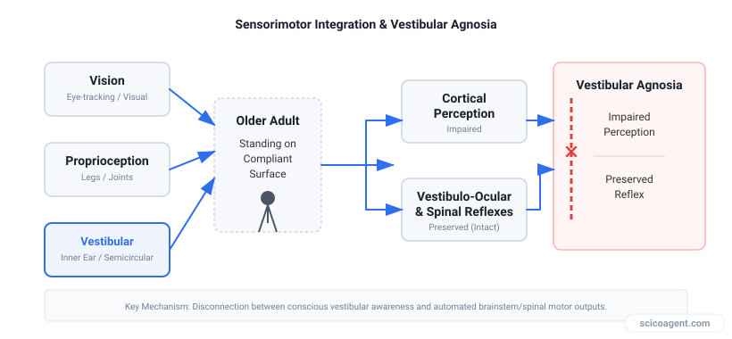
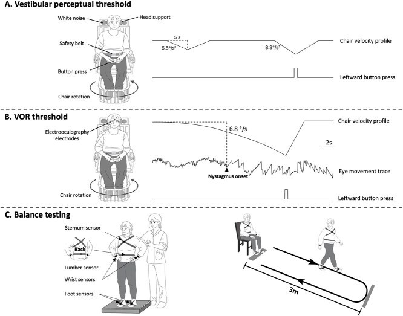
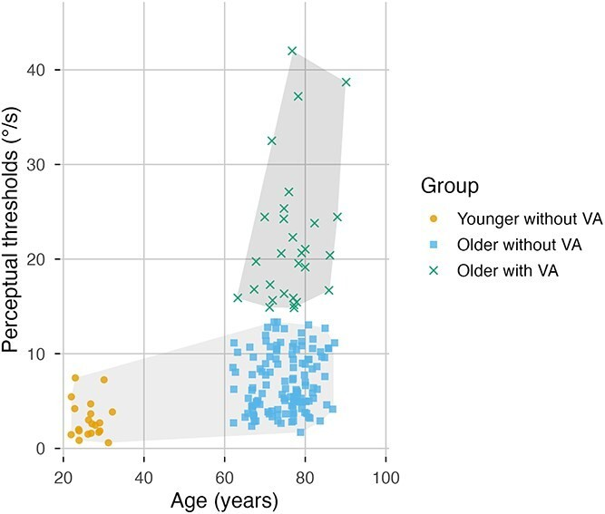

In brief
<ul style="margin:0;padding-left:20px;"><li style="margin:6px 0;line-height:1.5;">Approximately 18.7% of healthy community-dwelling older adults exhibit vestibular agnosia, defined as impaired self-motion perception despite intact inner-ear reflex function.</li><li style="margin:6px 0;line-height:1.5;">Elevated vestibular perceptual thresholds independently predict greater postural sway velocity during eyes-open standing on foam (adjusted β = 0.002, P = .03).</li><li style="margin:6px 0;line-height:1.5;">Despite links to static balance and cognitive scores, vestibular perceptual thresholds do not predict six-month prospective fall risk (adjusted OR = 0.99, P = .65).</li></ul>

How measuring conscious self-motion perception reveals unexpected truths about balance and aging.

### The Hidden Balance Deficit: Vestibular Agnosia

When older adults experience balance difficulties, clinicians typically look to muscle strength, vision, or peripheral nerve sensation in the feet. Yet a critical piece of the postural control system lives quietly inside the temporal bone. The vestibular system monitors self-motion and spatial orientation, feeding signals to the brain to keep the body upright. For decades, researchers assumed that if the inner ear reflexes worked properly, a person could consciously perceive movement just fine. 

Recent work by Yuxiao Li and colleagues challenges that assumption. They investigated a phenomenon known as vestibular agnosia, a condition where individuals show impaired conscious perception of self-motion despite having completely preserved peripheral reflex function. Think of it like a camera lens that focuses light perfectly onto a sensor, but the internal processor fails to render the image clearly on the screen. The hardware works, but the conscious interpretation fails.

*While balance decline in older adults is multifactorial, traditional assessments often miss central vestibular processing impairments where self-motion perception is lost despite intact reflexes.*

### Measuring Conscious Perception Separately from Reflexes

To study this disconnect, researchers need a way to separate conscious awareness from involuntary reflexes. The vestibulo-ocular reflex automatically stabilizes gaze when the head moves, and its threshold can be measured independently of what a person consciously feels. Li et al. (2026) recruited 166 community-dwelling older adults with a mean age of 75.4 years, alongside a younger control group, and seated them inside a vibration-free motorized rotating chair.

*Passive yaw-plane rotation setup and stimulus profiles used to objectively measure vestibular perceptual and vestibulo-ocular reflex thresholds. Figure 1 reproduced unchanged from Yuxiao Li et al. (2026). Vestibular perception, balance impairment, and fall risk in community-dwelling older adults. Age and Ageing. https://doi.org/10.1093/ageing/afag216. Licence: [CC BY](https://creativecommons.org/licenses/by/4.0/).*

During yaw-plane rotations, participants pressed a button as soon as they felt the chair move. By using a specialized staircase algorithm, the researchers determined each participant's vestibular perceptual threshold, which is the smallest rotation speed they could reliably detect. They also measured vestibulo-ocular reflex thresholds and assessed static balance using wearable inertial sensors while participants stood on compliant foam surfaces.

### What Impaired Perception Actually Predicts

When the researchers grouped the participants using K-means clustering based on age and perceptual thresholds, a clear pattern emerged. Approximately 18.7 percent of the older adults met the criteria for vestibular agnosia. These individuals had significantly higher perceptual thresholds, alongside poorer global cognition scores, reduced lower limb somatosensation, and higher anxiety levels.

*K-means clustering of age and average vestibular perceptual thresholds reveals that 18.7% of community-dwelling older adults fall into the high-threshold 'vestibular agnosia' group. Figure 3 reproduced unchanged from Yuxiao Li et al. (2026). Vestibular perception, balance impairment, and fall risk in community-dwelling older adults. Age and Ageing. https://doi.org/10.1093/ageing/afag216. Licence: [CC BY](https://creativecommons.org/licenses/by/4.0/).*

The clinical implications of this perceptual deficit show up during specific balance challenges. When standing quietly on a soft foam surface with their eyes open, participants with higher perceptual thresholds demonstrated greater sway velocity. 

| Metric | VA- Negative Group (n = 126) | VA+ Positive Group (n = 29) | P-Value |
| :--- | :--- | :--- | :--- |
| Perceptual Threshold (°/s) | 6.28 | 20.40 | <.001 |
| VOR Threshold (°/s) | 3.31 | 5.40 | .006 |
| MoCA Cognitive Score | 28 | 27 | .01 |
| Sit-to-Stand Duration (s) | 16.03 | 17.89 | .03 |

However, when researchers adjusted for covariates like age, sex, and reflex thresholds, associations with more complex tasks like the timed up-and-go test disappeared. 

### The Fall-Risk Paradox

Given that poor balance frequently leads to falls in older adults, the logical assumption is that failing to perceive self-motion consciously should translate directly into a higher fall rate. To test this hypothesis, the research team tracked participants prospectively over six months using detailed falls diaries. 

The results subvert expectations. Despite the clear association between elevated perceptual thresholds and increased postural sway during foam standing, vestibular perceptual thresholds did not predict prospective falls. The adjusted odds ratio for experiencing one or more falls was 0.99, showing no statistical relationship. 

This disconnect reveals a profound insight about human movement. Conscious awareness of movement and automated balance control rely on partially distinct neural pathways. An older adult can lose the conscious ability to feel subtle rotations without losing the deep, unconscious reflex loops that catch a stumble before it becomes a fall. Clinical assessments that focus solely on what a patient consciously perceives may miss how robustly the nervous system operates beneath the level of awareness.

## Sources
Yuxiao Li et al. (2026). Vestibular perception, balance impairment, and fall risk in community-dwelling older adults. Age and Ageing. https://doi.org/10.1093/ageing/afag216
