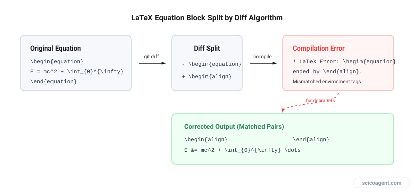

<div class="tldr" style="border:1px solid #e2e8f0;border-left:4px solid #2f6fed;background:#f8fafc;border-radius:10px;padding:16px 20px 14px;margin:0 0 30px;"><p style="margin:0 0 8px;font-weight:700;font-size:.8em;letter-spacing:.08em;text-transform:uppercase;color:#2f6fed;">In brief</p><ul style="margin:0;padding-left:20px;"><li style="margin:6px 0;line-height:1.5;">Standard diff tools often trigger compilation errors on complex LaTeX manuscripts containing nested equations and tables</li><li style="margin:6px 0;line-height:1.5;">The soul package provides a robust alternative to ulem for handling multiline deletions in diff preambles</li><li style="margin:6px 0;line-height:1.5;">Modern span-level alignment models offer more explainable change extraction than traditional lexical diffs</li></ul></div>

Moving beyond fragile visual diffs and compilation errors in scientific typesetting.

## Why Traditional Source Comparison Breaks Down

When tracking changes in a scientific manuscript written in LaTeX, most researchers immediately turn to traditional source-level comparison utilities. These tools operate by comparing line breaks and text tokens between two files. While this works well for plain text documents, LaTeX introduces a complex hierarchy of macros, environments, and mathematical structures. When a manuscript contains intricate tables, aligned equations, or custom macros, standard algorithms often fail to parse the syntax correctly. This mismatch frequently results in corrupted output files that refuse to compile.

Another common failure point involves package conflicts. Default setups often rely on the ulem package to handle strikethrough formatting for deleted text. However, when deletions span across multiple paragraphs or encounter complex formatting commands, the ulem package breaks entirely, leaving authors with cryptic compilation errors right before a submission deadline.


*How traditional diff algorithms corrupt LaTeX syntax during parsing*

## Configuring Preamble Workarounds for Standard Diffing

If you must rely on traditional diff generation, you can mitigate some formatting failures by swapping out the underlying strikethrough mechanism. Instead of using default configurations, you can configure the preamble of your generated diff file to use the soul package. This alternative approach handles multiline formatting more reliably and provides clearer visual distinction for deleted sections.

To implement this fix, modify the preamble of your generated comparison file with the following definitions:

```latex
\usepackage{soul}
\RequirePackage{color}\definecolor{RED}{rgb}{1,0,0}\definecolor{BLUE}{rgb}{0,0,1}
\providecommand{\DIFadd}[1]{{\protect\color{blue}\ul{#1}}}
\providecommand{\DIFdel}[1]{{\protect\color{red}\st{#1}}}
```

While this adjustment prevents many common rendering failures, it remains a surface-level patch. It does not solve the underlying problem of how text blocks and mathematical symbols are aligned across revisions.

## The Shift Toward Semantic Span-Level Alignment

To move beyond the limitations of lexical string matching, recent computational frameworks approach document revision through neural sentence alignment. As demonstrated in research on human revision processes [4] (Jiang et al., 2022), extracting fine-grained, span-level edits requires understanding the semantic context of a sentence rather than merely comparing character sequences. 

Similarly, modern evaluation frameworks leverage large language models to generate direct edit-level guidance [5] (Ziegenbein et al., 2026), offering a structured alternative to traditional diff-based extraction. These computational methods provide significantly more explainable edits because they evaluate changes at the level of scientific arguments and technical notation rather than raw text matching.

## Integrating Modern Comparison Into Your Writing Workflow

Understanding these underlying mechanics changes how you manage manuscript revisions. Whether you choose to manually patch your diff preambles or adopt newer neural alignment tools, the goal is to maintain document integrity without wasting hours troubleshooting broken compilation logs. We built Benjamin to handle inline LaTeX diffing and equation checks automatically. By shifting the comparison layer away from brittle string matching, you can focus entirely on the substance of your research.

## FAQ

### Why does latexdiff cause compilation errors on large manuscripts?
Standard comparison tools treat LaTeX code as a sequence of plain text lines rather than a structured tree. When complex equations, multi-column tables, or custom macros are split across revisions, the generated insertion and deletion tags often break the syntax required by the compiler.

### How does the soul package improve LaTeX diff rendering?
The soul package provides more robust handling of text decoration compared to standard underline packages. By redefining the addition and deletion commands in your document preamble to utilize soul, you avoid the paragraph-spanning crashes typical of older formatting packages.

### What is span-level edit extraction?
Span-level edit extraction is a computational approach that identifies changes based on complete clauses or semantic units rather than individual words or characters. This method aligns text versions logically, resulting in clearer and more explainable revision histories.

We often treat version control as a mechanical chore of marking text additions and deletions, as if a manuscript were merely a collection of words waiting to be counted. Yet the difficulty of tracking changes in LaTeX reveals something fundamental about scientific communication. Mathematics and code are not decorative layers added on top of prose; they are the structural skeleton of the argument itself. When your tools fail to understand that an equation is a single indivisible thought rather than a string of characters, no amount of preamble patching will save your build. The true bottleneck in scientific writing is never the formatting of the changes. It is the silent gap between what you meant to prove and what your notation actually says.

## Further reading

- [Alternative to Latexdiff](https://tex.stackexchange.com/questions/702076/alternative-to-latexdiff) (Q&A discussion)
- [Using latexdiff to highlight changes: alternatives for soul?](https://tex.stackexchange.com/questions/138633/using-latexdiff-to-highlight-changes-alternatives-for-soul) (Q&A discussion)
- [arXivEdits: Understanding the Human Revision Process in Scientific Writing](https://doi.org/10.18653/v1/2022.emnlp-main.641) (paper, Jiang et al., 2022)
- [A unified evaluation framework for revising inappropriate arguments with edit-level guidance](https://doi.org/10.3389/frai.2026.1869755) (paper, Ziegenbein et al., 2026)
