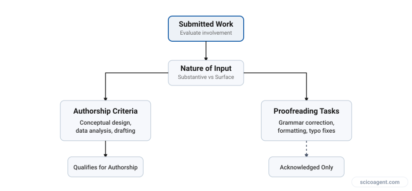

In brief
<ul style="margin:0;padding-left:20px;"><li style="margin:6px 0;line-height:1.5;">International guidelines require substantial intellectual contribution, not just grammar checks, for byline inclusion</li><li style="margin:6px 0;line-height:1.5;">Nearly half of listed co-authors fail to meet ethical contribution standards due to normalized quid pro quo practices</li><li style="margin:6px 0;line-height:1.5;">Crediting proofreaders in the acknowledgements preserves paper integrity and prevents future liability disputes</li></ul>

The ethical, professional, and practical costs of treating the manuscript byline as a currency for grammar checks.

Trading co-authorship for proofreading violates international ethical guidelines because minor grammatical and spelling corrections do not constitute a significant intellectual contribution. Authorship requires conceptual design, data analysis, or critical revision of intellectual content, making proofreading services more appropriately recognized in the acknowledgements section of a paper. 

For early career researchers navigating tight publishing pressures, the temptation to swap a line-edit for a byline can feel like a pragmatic bargain. Someone offers to clean up your syntax, and in return, you grant them permanent status as a co-creator of your scientific findings. Yet this transaction trades short-term convenience for long-term accountability risks, violating the core principles of scientific publishing.

## What international guidelines actually require for authorship

The boundaries of authorship are not a matter of local lab culture or personal opinion. According to the International Committee of Medical Journal Editors, legitimate authorship rests on three cumulative pillars: substantial contributions to conception, design, or data analysis; drafting or critically revising the intellectual content; and providing final approval of the version to be published [1]. 

*Why proofreading fails the authorship test*

Proofreading for grammar, punctuation, and spelling falls squarely outside these criteria. When an individual corrects dangling modifiers or fixes typographical errors, they are engaging in literacy brokering [5], which improves readability but adds zero intellectual weight to the research hypotheses or analytical conclusions. Listing such individuals as co-authors is widely classified as a form of misrepresentation [1].

| Contribution Type | Appropriate Recognition | Ethical Basis |
| :--- | :--- | :--- |
| Conceiving hypotheses, designing experiments, or analyzing data | Byline (Co-author) | Meets ICMJE criteria for intellectual ownership and accountability |
| Drafting or critically revising intellectual arguments | Byline (Co-author) | Shapes the scientific conclusions and scientific narrative |
| Correcting grammar, spelling, or formatting | Acknowledgements section | Linguistic assistance does not alter research findings or methodology |

## Why the trade of co-authorship for proofreading persists

Despite clear standards, honorary, guest, or gift authorship remains remarkably common. Surveys and bibliometric analyses estimate that nearly half of all listed co-authors do not actually meet international ethical guidelines [4]. This widespread non-compliance persists because academic environments often treat co-authorship as a traded commodity or a professional courtesy rather than a strict attestation of responsibility [3].

Early career academics frequently face institutional pressure where power gifting or crony ordering is normalized as a rite of passage [4]. When senior colleagues or transactional peers demand co-authorship in exchange for unwanted proofreading services, refusing carries real career anxieties. Opposing these demands can result in professional friction or retaliation, particularly for graduate students and postdocs who rely on institutional advocates [4].

Yet accepting honorary authors introduces severe downstream vulnerabilities. Every listed co-author must agree to be accountable for the integrity of the research [1]. If a paper faces a post-publication correction or a retraction due to data integrity issues, honorary authors frequently claim they were unaware of their inclusion or try to distance themselves from the work, leaving the primary researchers exposed to institutional fallout [3].

## How to handle authorship demands professionally

When faced with a colleague or supervisor demanding co-authorship in exchange for minor proofreading, navigating the refusal requires a structured approach that protects both your project and your professional standing.

1. **Acknowledge the linguistic help publicly:** Move the individual to the acknowledgements section of the paper. This honors their labor without inflating their credentials, matching the exact scope of their contribution [2].
2. **Explicitly decline the authorship swap:** State clearly that institutional guidelines and journal policies restrict byline inclusion to those who contribute directly to the intellectual design or data analysis of the study [2].
3. **Refuse unwanted services:** If a colleague attempts to force proofreading upon you specifically to manufacture leverage for a byline, decline their editorial services entirely [2].
4. **Escalate through proper channels:** When an immediate superior or department head demands authorship coercively and communication breaks down, consult an institutional ethics officer, ombudsperson, or graduate advisor to mediate [2].

We built Benjamin to check scientific grammar, units, and equations while leaving manuscript revision decisions entirely in your hands.

## FAQ

### Is it acceptable to list a professional copyeditor as a co-author if they significantly rewrite the discussion section?
If a copyeditor contributes substantive intellectual content, reframes the scientific arguments, or helps interpret the data, their role moves past proofreading. However, commercial or institutional copyeditors are typically acknowledged as paid service providers rather than co-authors, provided their work remains strictly editorial.

### What should I do if a co-author refuses to sign off on the final manuscript version?
Every legitimate co-author must provide final approval of the published version. If a contributor refuses or is unreachable, you must determine whether their prior contributions meet the threshold for authorship; if they do not approve the final text, they generally cannot be listed as an author.

### Does acknowledging someone imply they endorse all conclusions of the paper?
No. The acknowledgements section simply expresses gratitude for assistance, technical support, or proofreading. It does not carry the formal accountability or intellectual endorsement required of signatories in the paper byline.

When researchers treat the byline as a cheap currency to outsource mechanical grammar checks, they reveal a deeper contradiction in the academic enterprise. It turns authorship from a solemn record of scientific accountability into a hollow administrative token, proving that the greatest threat to research integrity is often not external fraud, but the quiet erosion of what an author's name actually means.

## Further reading

- [Exchanging co-authorship for proofreading?](https://academia.stackexchange.com/questions/83787/exchanging-co-authorship-for-proofreading) (Q&A discussion)
- [Does *co-authorship as professional courtesy* extend to bare bones proofreading?](https://academia.stackexchange.com/questions/108335/does-co-authorship-as-professional-courtesy-extend-to-bare-bones-proofreading) (Q&A discussion)
- [Who is innocent in authorship misconduct?](https://doi.org/10.13918/j.issn.2095-8137.2016.3.117) (paper, Liu, 2016)
- [Co-authorship as a traded commodity: the experiences of early career education academics in Hong Kong, Canada and the UK](https://doi.org/10.1080/03075079.2026.2633517) (paper, Macfarlane et al., 2026)
- [Exploring postsecondary students' use of proofreading services at a Canadian university](https://doi.org/10.14288/1.0368726) (paper, Conrad, 2018)
