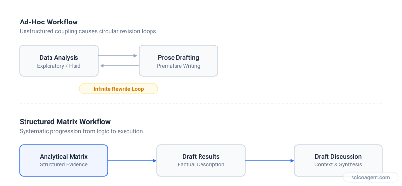
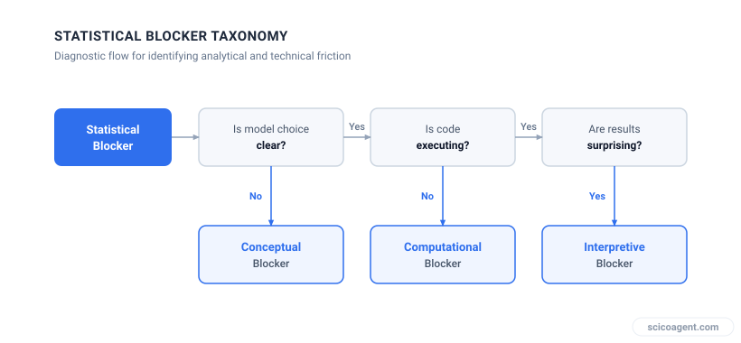

In brief
<ul style="margin:0;padding-left:20px;"><li style="margin:6px 0;line-height:1.5;">Stalling on a first paper draft is usually caused by coupling narrative writing directly to ongoing statistical analysis</li><li style="margin:6px 0;line-height:1.5;">Isolating statistical bottlenecks into conceptual, computational, and interpretive categories restores drafting momentum</li><li style="margin:6px 0;line-height:1.5;">Building a results-first analytical matrix prevents endless re-analysis cycles and establishes clear boundaries for manuscript sections</li></ul>

A systematic framework for navigating statistical blockers and unhelpful mentorship when writing your first scientific publication

I have been writing my first paper for six months and I am honestly thinking about quitting. 

This phrase, echoed regularly by PhD students across disciplines, usually comes with a familiar set of compounding factors: complex statistical analysis, a dataset that feels slightly intractable, and an advisor whose feedback is either absent or limited to vague instructions like "fix the stats." When progress stalls for months, researchers tend to blame their personal discipline, their writing speed, or their statistical competency. 

The core issue is rarely a lack of skill or effort. Instead, stalling on a first paper is almost always a structural failure in how the workflow is sequenced. When statistical evaluation and prose composition are tightly coupled, every hesitation in analysis completely halts the drafting process.

## The Cognitive Trap of Concurrent Analysis and Writing

When writing a first paper, researchers often attempt to draft the Introduction and Methods while simultaneously performing secondary statistical analyses. This creates an unstable feedback loop. A unexpected p-value or unclear interaction effect prompts a return to data cleaning, which invalidates the written draft of the Results, which in turn alters the rationale framed in the Introduction.

*Uncoupling data analysis from prose composition prevents endless manuscript revision loops.*

To break this cycle, you must uncouple analytical decisions from narrative drafting. This requires treating data analysis and text generation as two distinct, non-overlapping phases governed by a structured framework.

## A Three-Step Framework to Restore Manuscript Momentum

### Step 1: Construct an Analytical Matrix
Before writing a single paragraph of narrative text, consolidate all statistical outputs into a standardized analytical matrix. A manuscript cannot be written directly from raw code outputs or scattered statistical software logs. 

| Dataset / Variable Group | Primary Question / Hypothesis | Statistical Test Applied | Key Output (Effect Size, CI, p-value) | Manuscript Status |
| :--- | :--- | :--- | :--- | :--- |
| Variable Group A | Main effect of treatment vs control | Two-sample Welch t-test | d = 0.62, 95% CI [0.15, 1.09], p = 0.012 | Finalized (Figure 1) |
| Variable Group B | Interaction across temporal parameters | Two-way ANOVA with Tukey HSD | F(2, 48) = 1.14, p = 0.328 | Null result (Include in Text) |
| Variable Group C | Covariate adjustment for batch effects | Linear mixed-effects model | Beta = 0.04, SE = 0.02, p = 0.081 | Blocker (Requires Advice) |

By cataloging outputs in a matrix, you transform ambiguous statistical questions into explicit binary outcomes: either the analysis is complete and ready to draft, or it remains an active blocker requiring targeted consultation.

### Step 2: Categorize and Isolate Statistical Blockers
When statistical doubts halt your progress, diagnose the specific nature of the friction. Statistical blockers fall into three precise categories, each requiring a different strategy:

1. **Conceptual Blockers**: You are unsure which test correctly models your data structure (for example, nested data requiring mixed models versus independent observations).
2. **Computational Blockers**: You know the correct statistical model but face implementation errors in R, Python, or specialized software.
3. **Interpretive Blockers**: The analysis executes correctly, but the results are ambiguous, non-significant, or counterintuitive.

*Categorizing statistical friction enables targeted problem-solving rather than generalized procrastinating.*

If a mentor is unresponsive or unhelpful, presenting them with a vague statement like "I am struggling with the statistics" almost guarantees a unproductive response. However, if you isolate the issue into one of these three categories and present a specific choice, mentor interactions become actionable:

* *Vague query:* "My statistics aren't working."
* *Targeted query:* "My data is nested by site, so I implemented a linear mixed-effects model with site as a random intercept. Is a fixed-effects approach more appropriate given our four-site sample size?"

### Step 3: Execute a Results-First Drafting Sequence
Never write a paper chronologically from the Introduction onward. The Introduction requires a precise framing that can only be established once the statistical findings are fixed. Follow this sequence:

1. **Methods and Results**: Write these simultaneously using the finalized items from your Analytical Matrix. Describe the analytical pipeline strictly as performed.
2. **Figures and Tables**: Format visual displays as self-contained units. Captions must clearly state sample sizes, specific statistical tests, and error bar definitions.
3. **Discussion**: Frame your interpretation around the validated effect sizes and limitations identified during analysis.
4. **Introduction**: Write the Introduction last. Define the scientific gap specifically to lead into the exact results you have compiled.

## Worked Example: Overcoming a Stalled Draft

Consider a research project examining environmental stress responses in cell cultures. The researcher spent four months drafting an Introduction while repeatedly re-running regressions to account for unexpected variance across biological replicates.

By applying the Analytical Matrix:
1. The researcher explicitly defined the primary outcome measure (cell viability) and locked the primary analysis (Welch t-test).
2. The unexpected variance was categorized as an *Interpretive Blocker*. Rather than endlessly re-analyzing the dataset to remove variance, the high variance was formally recognized as a legitimate biological finding.
3. The researcher drafted the Results section in two days using pre-generated values from the matrix, framing the high variance within the Discussion as a limitation and potential avenue for future research.

## The Underlying Mechanism of Writing Paralysis

The feeling of running in circles on a first paper is rarely caused by a lack of writing capability or an intrinsic inability to grasp statistics. It stems from treating a manuscript draft as a tool for figuring out what your data means while you write it. 

When you expect prose drafting to clarify unfinished statistical thinking, any statistical ambiguity will naturally paralyze your writing. Conversely, when statistical work is isolated, categorized, and cataloged prior to sentence construction, drafting becomes a structured task of translation rather than an overwhelming process of simultaneous discovery.

The productive realization for any early-career researcher is this: the deep friction experienced during drafting is not evidence that you do not understand your work. It is the precise mechanism by which implicit analytical gaps are forced into explicit view. The manuscript draft does not fail because you are stuck; the draft stalls specifically because it is exposing the exact logical boundaries of your dataset that require formal definition.
